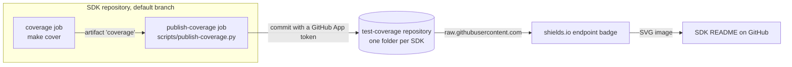

# Coverage badges

Every SDK README shows a line coverage badge next to its CI status badges. This page explains where the
number comes from, when it changes, how to check it without the badge, and what to do when the badge is
wrong. The coverage requirements, the `make cover` contract, the layout of the `test-coverage` repository
and the one-time GitHub App setup are described in [test coverage requirements](test-coverage-requirements.md).

## What the badge shows

- **Line coverage of the SDK library code** (the "Measured code" column of the
  [`make cover` table](test-coverage-requirements.md#make-cover--the-same-contract-in-every-sdk)), as computed
  by `scripts/coverage.py`, rounded to one decimal: `summary.json` says `88.15`, the badge says `88.2%`.
- **From the last push to the SDK's default branch** (`main`, `v4` for go) whose coverage job succeeded.
  Pull requests and other branches never change it.
- **From one configuration** when the SDK is tested on several:

  | SDK | Job and configuration that produce the number |
  |-----|-----------------------------------------------|
  | dart | `build` |
  | dotnet | `coverage`, .NET 10 |
  | go | `coverage`, Go `stable` |
  | java | `test`, Java 21 |
  | node | `build`, Node.js `lts/*` |
  | php | `coverage`, PHP 8.3 |
  | python | `build`, Python 3.12 |
  | swift | `linux-test`, Ubuntu 24.04 |

The `publish-coverage` job `needs` that job. If the coverage gate fails (coverage below the threshold, or a
failing test), nothing is published and the badge keeps the previous value. A drop below 80% therefore shows
up as a red CI status badge and a failed run, not as a lower coverage badge.

## How the badge is built



**Writing (CI, on every push to the default branch):**

1. `make cover` runs the tests under the SDK's native coverage tool and passes the report to
   `scripts/coverage.py`, which writes `coverage/coverage-badge.json`:

   ```json
   {
     "schemaVersion": 1,
     "label": "coverage",
     "message": "88.2%",
     "color": "green"
   }
   ```

   This is a complete [shields.io endpoint](https://shields.io/badges/endpoint-badge) document: the label,
   the text and the colour of the badge are all decided here. The colour scale is `badge_color()` in
   `scripts/coverage.py`.
2. The job uploads that file, `coverage/coverage-summary.json` and the native report as the workflow
   artifact `coverage`. The job has read-only access to the SDK repository and no other credentials.
3. The `publish-coverage` job downloads the artifact, gets a token that can write only to the `test-coverage`
   repository, and runs `scripts/publish-coverage.py <sdk>`. The script replaces the `<sdk>/` folder of
   `test-coverage` and pushes one commit, for example
   `python: 88.15% (aspose-barcode-cloud/Aspose.BarCode-Cloud-SDK-for-Python@06122b5)`.

**Reading (whenever someone opens a README):**

1. The README contains, for the Python SDK:

   ```markdown
   [](https://github.com/aspose-barcode-cloud/test-coverage)
   ```

   The other SDKs differ only in the folder name: `dart`, `dotnet`, `go`, `java`, `node`, `php`, `python`,
   `swift`.
2. GitHub loads images in READMEs through its own image proxy, which requests the badge from shields.io.
3. shields.io fetches the `url` parameter, the `coverage-badge.json` from `main` of `test-coverage`, and draws
   it. It adds nothing of its own: whatever the JSON says is what the badge shows.

The SDK repositories are never written by CI. A separate repository and a GitHub App installed only on it
mean that even a compromised SDK workflow can, at worst, overwrite coverage files.

## When a new value appears

1. **After a push to the default branch, usually a merged pull request.** The workflows have no schedule, so
   nothing else updates the badge.
2. **After the whole coverage job finishes,** not just `make cover`. Some jobs run more steps after the gate:
   in Dart the snippets step takes about eight minutes more.
3. **After the caches expire.** `raw.githubusercontent.com` serves the JSON with `Cache-Control: max-age=300`,
   and shields.io and GitHub's image proxy cache the image on top of that, so the README can lag the commit in
   `test-coverage` by several minutes. Reloading the page does not bypass these caches.

To publish again without a new commit, for example after a transient failure of the token step, open the
latest run of the default branch in the SDK's Actions tab and re-run the failed `publish-coverage` job. A
re-run of a push run is still a push run, so the job is not skipped.

## Checking the current value

- The [`test-coverage` README](https://github.com/aspose-barcode-cloud/test-coverage) shows the badges of
  all SDKs together.
- The number with its source commit and workflow run, without the caches:

  ```bash
  gh api repos/aspose-barcode-cloud/test-coverage/contents/python/summary.json -H "Accept: application/vnd.github.raw"
  ```

- The coverage history of one SDK, one commit per publish:

  ```bash
  gh api "repos/aspose-barcode-cloud/test-coverage/commits?path=python&per_page=10" -q '.[].commit.message'
  ```

- Before pushing: `make cover` in the SDK prints the same number (`Line coverage: 88.15% (...)`) and writes
  the same `coverage/coverage-badge.json`. `scripts/publish-coverage.py` is for CI only: it needs the app
  token and the GitHub Actions environment.

## Troubleshooting

| Symptom | Cause | What to do |
|---------|-------|------------|
| The badge shows an error instead of a percentage | `test-coverage` has no folder for this SDK yet: nothing was published since the setup, or the first run after the merge is still in progress | Wait for the run on the default branch to finish; check that the `publish-coverage` job ran (see below) |
| The badge shows an error, and the folder exists | The folder name in the README URL is wrong, e.g. `nodejs` or `net` instead of `node` or `dotnet` | Fix the URL in `codegen/Templates/<lang>/README*.mustache` and regenerate the SDK |
| The badge keeps the old value after a merge | The run is still in progress, a cache has not expired yet, or the coverage job failed (then nothing is published, by design) | Open the run in the SDK's Actions tab; if a publish commit for that SDK commit is in `test-coverage`, it is only the cache |
| `publish-coverage` is skipped on a push to the default branch | The organization variable `COVERAGE_APP_CLIENT_ID` is not set, or its repository access does not include this repository | Organization settings → Secrets and variables → Actions → Variables → `COVERAGE_APP_CLIENT_ID` → repository access |
| `publish-coverage` is skipped on a pull request | Expected: only pushes to the default branch publish | — |
| The token step fails with `Integration not found` | `COVERAGE_APP_CLIENT_ID` does not match the app's Client ID (this happened once with the letter `O` typed instead of the digit `0`) | Copy the Client ID again from the app page (General → About) |
| The token step fails with another authentication error | The secret `COVERAGE_APP_PRIVATE_KEY` is missing for this repository, or its key was deleted on the app page; or the app is not installed on `test-coverage` | Check the secret's repository access, generate a new private key if needed (see below), check the app installation |
| `Push attempt 1 failed, retrying`, then `Could not publish ...` | Several SDKs published at the same moment more than three times in a row, or a branch protection rule on `main` of `test-coverage` rejects the app | Re-run the job; if a rule rejects it, allow the app to bypass that rule |
| Warning `Input 'app-id' has been deprecated` | The workflow passes `app-id` to `actions/create-github-app-token` | Use `client-id: ${{ vars.COVERAGE_APP_CLIENT_ID }}`, as all SDK workflows do now |
| The colour does not match the number | The colour is decided at publish time; the scale was changed after the last publish | It changes with the next publish of that SDK |

## Changing and maintaining the badges

- **Label, text format or colour scale:** edit `write_badge()` or `badge_color()` in `scripts/coverage.py`
  here, regenerate the SDKs (`scripts/copy-common-files.bash` copies the script into each), and merge them.
  Each badge changes with the next publish of its SDK.
- **Badge style:** append a shields.io query parameter such as `&style=flat-square` to the image URL in the
  README templates. The style is decided by shields.io, not by the JSON.
- **Where the Markdown lives:** `codegen/Templates/<lang>/README.mustache` (`README.template.mustache` for
  nodejs). Do not edit an SDK README directly; regeneration overwrites it. `scripts/check-badges.bash`
  validates only workflow status badges and ignores the coverage badge.
- **Rotating the private key:** on the app page generate a new private key, put the new `.pem` contents into
  the organization secret `COVERAGE_APP_PRIVATE_KEY`, then delete the old key on the app page. Nothing in the
  SDK repositories changes.
- **Stopping the publishing:** delete the organization variable `COVERAGE_APP_CLIENT_ID`. The
  `publish-coverage` jobs are then skipped instead of failing, and the badges keep the last published values.
  Uninstalling the app or deleting the secret also stops the writes, but the jobs then fail at the token step.
- **Moving `test-coverage`:** set `COVERAGE_REPOSITORY` for `scripts/publish-coverage.py`, change
  `owner` and `repositories` of the token step in the SDK workflows, install the app on the new repository and
  change the URLs in the README templates.
- **Adding an SDK:** see [Adding a new SDK](test-coverage-requirements.md#adding-a-new-sdk).
